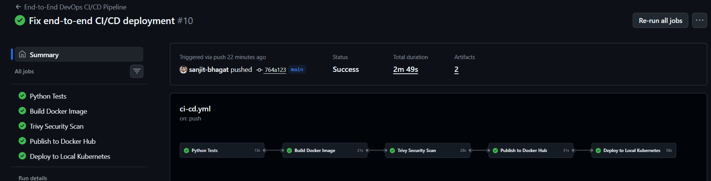
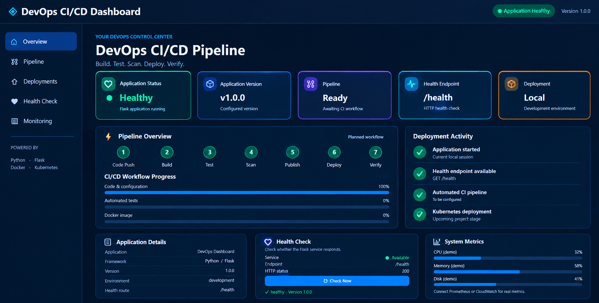
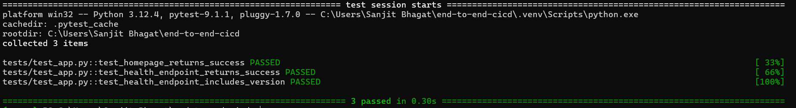
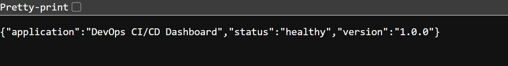

# 🚀 End-to-End DevOps CI/CD Pipeline

An automated CI/CD pipeline for a Python Flask application using GitHub Actions, Docker, Trivy, Docker Hub, and Kubernetes (Kind).

This project demonstrates how to automate application testing, container building, security scanning, image publishing, and deployment to a local Kubernetes cluster.

## 📌 Project Overview

The project contains a Flask-based DevOps dashboard that displays application health, version information, pipeline stages, and deployment details.

Whenever code is pushed to the `main` branch, GitHub Actions automatically runs the pipeline to test, build, scan, publish, and deploy the application.

## 🛠️ Technologies Used

| Technology | Purpose |
|---|---|
| Python | Application development |
| Flask | Web framework |
| Pytest | Automated unit testing |
| Docker | Application containerization |
| GitHub Actions | CI/CD automation |
| Trivy | Container vulnerability scanning |
| Docker Hub | Docker image registry |
| Kubernetes | Application deployment and orchestration |
| Kind | Local Kubernetes cluster |
| PowerShell | Windows self-hosted runner |
| Git & GitHub | Version control and source code hosting |

## 🏗️ CI/CD Pipeline

The pipeline contains five automated jobs:

1. **Python Tests:** Installs dependencies and runs automated tests using pytest.
2. **Build Docker Image:** Builds the Flask application container image.
3. **Trivy Security Scan:** Scans the image for HIGH and CRITICAL vulnerabilities.
4. **Publish to Docker Hub:** Publishes the image using a commit-specific tag and the `latest` tag.
5. **Deploy to Local Kubernetes:** Uses a Windows self-hosted GitHub Actions runner to deploy the application to a local Kind cluster and verify the rollout.

## 📸 Project Screenshots

### 1. Successful GitHub Actions Pipeline

The screenshot below shows all five CI/CD jobs completing successfully, including testing, Docker image building, security scanning, publishing, and Kubernetes deployment.



### 2. Application Dashboard

The Flask dashboard displays the application status, version, pipeline stages, health-check information, and deployment activity.



### 3. Python Unit Test Results

All three application tests passed successfully.



### 4. Application Health Endpoint

The health endpoint returns the application's status and version in JSON format.



## ❤️ Health Check

The application provides a health endpoint:

`GET /health`

Example response:

```json
{
  "application": "DevOps CI/CD Dashboard",
  "status": "healthy",
  "version": "1.0.0"
}
```

## ⚙️ Run the Application Locally

### 1. Clone the repository

```bash
git clone https://github.com/sanjit-bhagat/End-to-End-CICD-Pipeline.git
cd End-to-End-CICD-Pipeline
```

### 2. Install dependencies

```bash
python -m pip install -r requirements.txt
```

### 3. Start the application

```bash
python app.py
```

Open the application at:

`http://localhost:5000`

Health endpoint:

`http://localhost:5000/health`

## 🧪 Run Unit Tests

Run the following command:

```bash
python -m pytest -v
```

The current test suite contains three tests covering the homepage, health endpoint, and application version.

## 🐳 Build and Run with Docker

Build the image:

```bash
docker build -t devops-dashboard:latest .
```

Run the container:

```bash
docker run --rm -p 5000:5000 devops-dashboard:latest
```

Open `http://localhost:5000` in your browser.

## ☸️ Deploy to Kubernetes

Ensure your Kind cluster is running and your Kubernetes manifests are configured with the correct Docker Hub image.

Apply the manifests:

```bash
kubectl apply -f k8s/deployment.yaml
kubectl apply -f k8s/service.yaml
```

Check the deployment:

```bash
kubectl get deployments
kubectl get pods
kubectl get services
```

Wait for the rollout:

```bash
kubectl rollout status deployment/devops-dashboard
```

Access the application using port forwarding:

```bash
kubectl port-forward service/devops-dashboard 8080:80
```

Open `http://localhost:8080`.

## 🔐 GitHub Actions Secrets

Configure the following repository secrets under **Settings → Secrets and variables → Actions**:

- `DOCKERHUB_USERNAME`
- `DOCKERHUB_TOKEN`

These secrets allow the workflow to authenticate to Docker Hub without storing credentials in the workflow file.

## 📂 Project Structure

```text
End-to-End-CICD-Pipeline/
├── app.py
├── requirements.txt
├── Dockerfile
├── tests/
│   └── test_app.py
├── k8s/
│   ├── deployment.yaml
│   └── service.yaml
├── screenshots/
│   ├── github-actions-success.png
│   ├── dashboard.png
│   ├── pytest-results.png
│   └── health-check.png
└── .github/
    └── workflows/
        └── ci-cd.yml
```

## 🎯 Key Learnings

- Automated Python testing with pytest
- Containerizing applications using Docker
- Building multi-job CI/CD workflows with GitHub Actions
- Scanning container images for security vulnerabilities
- Publishing versioned images to Docker Hub
- Deploying and verifying applications on Kubernetes
- Using a Windows self-hosted runner to deploy to a local Kind cluster
- Configuring application health checks

## 👨‍💻 Author

**Sanjit Bhagat**

Aspiring DevOps Engineer | Python | Docker | Kubernetes | GitHub Actions | AWS

- GitHub: [sanjit-bhagat](https://github.com/sanjit-bhagat)
- LinkedIn: [Sanjit Bhagat](https://linkedin.com/in/sanjit-bhagat-39a9302a7/)

---

⭐ This project demonstrates practical DevOps skills through an automated application delivery workflow.
